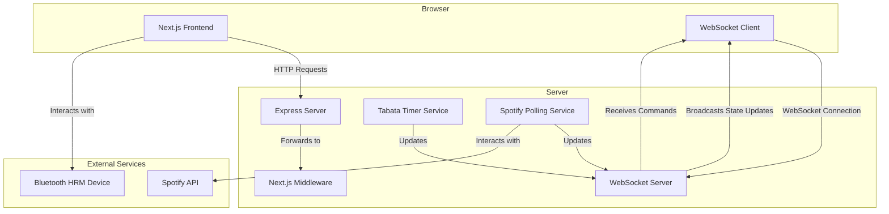

# HRM (Heart Rate Monitor) Dashboard

A real-time heart rate monitoring dashboard built with Next.js, Material-UI, WebSockets, and Spotify integration. Features a custom Express server for stateful WebSocket connections, Tabata timer with audio feedback, and live HR zone visualization.

**⚠️ Important:** This project uses a custom server entry (`server.ts`) that runs Next.js, a persistent WebSocket server, and background services. The server is stateful and **cannot be deployed on serverless platforms** like Vercel.

> **Last verified:** 2026-11-20 against `leader` (see [README currency checks](#readme-currency-checks)).

## Table of Contents

- [HRM (Heart Rate Monitor) Dashboard](#hrm-heart-rate-monitor-dashboard)
  - [Table of Contents](#table-of-contents)
  - [Features](#features)
  - [Component Status](#component-status)
  - [Quick Start](#quick-start)
    - [One-Click Start with DevContainer (Recommended)](#one-click-start-with-devcontainer-recommended)
    - [Manual Setup](#manual-setup)
    - [Production Build](#production-build)
  - [Project Structure](#project-structure)
  - [Available Commands](#available-commands)
    - [Primary Scripts](#primary-scripts)
    - [Navigation Shortcuts](#navigation-shortcuts)
    - [Testing \& Verification](#testing--verification)
  - [Environment Variables](#environment-variables)
    - [Spotify Setup](#spotify-setup)
    - [Audio System](#audio-system)
  - [Documentation](#documentation)
  - [Architecture Overview](#architecture-overview)
    - [Custom Stateful Server](#custom-stateful-server)
    - [Real-time Data Flow](#real-time-data-flow)
    - [Architecture Diagram](#architecture-diagram)
    - [Key Services](#key-services)
  - [Development Guidelines](#development-guidelines)
  - [Contributing](#contributing)
  - [Production Readiness Focus](#production-readiness-focus)
  - [README currency checks](#readme-currency-checks)
  - [License](#license)
  - [Acknowledgments](#acknowledgments)

## Features

- **Real-time Heart Rate Monitoring** - WebSocket streaming from Bluetooth HRM devices or mock client
- **Dual-Mode Timer** - Tabata (work/rest intervals) and Stopwatch (count-up) modes with 5-second prepare countdown
- **Audio Feedback** - Original HRM beep sounds for countdown (3-2-1) and phase transitions
- **HR Zone Visualization** - Large percentage tiles with color-coded zones and user names/ages
- **Spotify Integration** - Full playback control, device selection, volume control, and now-playing display
- **Mock HRM Client** - Test interface with zone buttons, device ID, and noise simulation (available at `/client/mock`)
- **Control Panel** - Mobile-optimized UI with timer controls, Spotify controls, and configuration steppers (available at `/client/control`)
- **Bluetooth HRM Support** - Real heart rate monitor connection via Web Bluetooth API (available at `/client/connect`)
- **Visual Regression Tests** - Playwright screenshot-based testing

## Component Status

Status is based on the code, the unit and Playwright tests, and the docs as of this commit. "Working" means the feature is implemented and covered by unit tests and, where noted, Playwright visual specs. It does not mean verified against live hardware or live Spotify accounts in CI.

| Component                                                                            | Status          | Evidence                                                                                                                                                                                          |
| ------------------------------------------------------------------------------------ | --------------- | ------------------------------------------------------------------------------------------------------------------------------------------------------------------------------------------------- |
| Custom Express and WebSocket server (`server.ts`, `utils/socketManager`)             | Working         | Unit tests for socket manager, middleware and health routes. `realtime-resilience.spec.ts` and `multiple-mock-hrm.spec.ts` run in Playwright.                                                     |
| Tabata and stopwatch timer (`services/tabataTimer.ts`)                               | Working         | Unit tests in `tests/unit/services/tabataTimer.test.ts`. `timer-ui-sync.spec.ts`, `timer-audio.spec.ts`, `workout-pause.spec.ts` and `vrt-timer-controls.spec.ts` cover the UI.                   |
| Dashboard (`/`) and workout grid from the Google Doc                                 | Working         | `services/googleDocParser.ts`, `GET /api/workout` and `WorkoutPhaseGrid` have unit tests. `vrt-dashboard`, `vrt-workout-*` specs cover rendering.                                                 |
| HR zones, calorie estimation (`lib/shared/hr-zones.ts`, `lib/calorie-estimation.ts`) | Working         | Unit tests in `tests/unit/lib` and `tests/unit/utils`. Method documented in [calorie-estimation](docs/calorie-estimation.md).                                                                     |
| Control panel (`/client/control`)                                                    | Working         | Unit tests in `tests/unit/app/client/control`. `vrt-control-panel.spec.ts`.                                                                                                                       |
| Mock HRM client (`/client/mock`)                                                     | Working         | Unit tests in `tests/unit/app/client/mock`. `vrt-mock-hrm-client.spec.ts` and the multi-client Playwright spec use it.                                                                            |
| Bluetooth HRM connect (`/client/connect`, `hooks/useBluetoothHRM`)                   | Working         | Extensive hook tests (battery, race, recovery). `vrt-connect-page.spec.ts` and `bluetooth-flow.spec.ts` use a mocked Bluetooth API. Real straps are not exercised in CI.                          |
| Spotify playback, devices and playlists                                              | Working         | Unit tests for token, device, polling and playlist services plus Spotify hooks and API routes. `vrt-spotify-*` specs run against mocks. Live Spotify accounts are not exercised in CI.            |
| Settings and Spotify selection pages                                                 | Working         | Unit tests in `tests/unit/app/client/settings` and `spotify-selection`. `vrt-spotify-selection.spec.ts`.                                                                                          |
| Experiments tab (`/client/experimental`)                                             | Experimental    | Session recording and analytics stored in browser storage only. Has unit tests and `vrt-experimental.spec.ts`, but it is not part of the live workout flow described in [VISION](docs/VISION.md). |
| Debug pages and `/api/debug/*`                                                       | Experimental    | Gated by `lib/debug-gate.ts` and `lib/debug-guard.ts` for production. Intended for diagnostics, not end users.                                                                                    |
| Google OAuth local flow (`tests/playwright/oauth`)                                   | Experimental    | The spec is skipped when `CI` is set, so it only runs on a developer machine with a Chrome profile.                                                                                               |
| Strava activity upload                                                               | Not implemented | No Strava code exists. It is described in [PRIVACY](docs/PRIVACY.md) and [VISION](docs/VISION.md) as planned.                                                                                     |
| Broken                                                                               | None known      | No failing or skipped-because-broken tests. The only skipped Playwright tests are the OAuth local test and the lint and `build:server` checks in `infrastructure.spec.ts`.                        |

## 🔒 Strava Compliance & Privacy

**Data Usage Disclaimer:**
This application is a **local data generator**.

- **Live Dashboard:** The heart rate tiles and group displays shown in screenshots utilize **direct Bluetooth sensor data**. They do **not** display data fetched from Strava, complying with Strava API Brand Guidelines regarding user privacy.
- **AI Features:** Any AI/LLM integration (e.g., Gemini) analyzes strictly **local project metadata** or **locally recorded Bluetooth logs**. No data fetched from the Strava API is ever sent to AI models.
- **Strava Integration:** Planned, not implemented yet. No Strava code exists in the repository today. The intent is **upload only** of completed activities (write-only).

## Quick Start

### One-Click Start with DevContainer (Recommended)

This repository is configured with a VS Code DevContainer, which provides a fully automated, "one-click" setup.

1.  **Prerequisites**:
    - [Docker Desktop](https://www.docker.com/products/docker-desktop/) installed and running.
    - [Visual Studio Code](https://code.visualstudio.com/) with the [Dev Containers extension](https://marketplace.visualstudio.com/items?itemName=ms-vscode-remote.remote-containers).

2.  **Launch**:
    - Open the repository in VS Code.
    - Click the "Reopen in Container" button when prompted.

That's it. The container will build, install all dependencies (`pnpm install` and Playwright), and create a `.env.local` file for you. Once the container is ready, you can start the development server:

```bash
pnpm run dev
```

### Manual Setup

If you are not using the DevContainer, you can set up the project manually:

#### Prerequisites

Before setting up the project locally, ensure you have the following installed on your system:

- **Node.js 24** (the version pinned in `.nvmrc` and used by CI and the deploy workflow; `package.json` `engines` requires `>=22.22.1`)
  - Download from [nodejs.org](https://nodejs.org/) or run `nvm use`
  - Verify installation: `node --version`

- **pnpm 9.15.9** (pinned by the `packageManager` field in `package.json`)
  - Recommended: `corepack enable` (CI does `corepack prepare pnpm@9.15.9 --activate`)
  - Alternative: `npm install -g pnpm`
  - Verify installation: `pnpm --version`

- **Git**
  - Download from [git-scm.com](https://git-scm.com/)
  - Verify installation: `git --version`

#### Step-by-Step Setup Instructions

**1. Clone the Repository**

```bash
# Clone the repository to your local machine
git clone https://github.com/arii/hrm.git

# Navigate to the project directory
cd hrm
```

**2. Install pnpm (if not already installed)**

```bash
# Install pnpm globally using npm
npm install -g pnpm

# Verify pnpm installation
pnpm --version
```

**3. Install Project Dependencies**

```bash
# Install all required dependencies using pnpm
pnpm install --frozen-lockfile
```

This will install all the Node.js packages required by the project and also set up pre-commit hooks using Husky to automatically lint and format your code when you commit.

**4. Install Playwright Browser Dependencies**

```bash
# Install Playwright browsers for testing
pnpm exec playwright install --with-deps
```

**5. Set Up Environment Variables**

```bash
# Create your local environment file from the example
cp .env.example .env.local
```

Then open `.env.local` and fill in the required values:

```bash
# Spotify OAuth credentials (get these from developer.spotify.com/dashboard)
SPOTIFY_CLIENT_ID=your_client_id_here
SPOTIFY_CLIENT_SECRET=your_client_secret_here

# NextAuth.js configuration
NEXTAUTH_URL=http://127.0.0.1:3000
NEXTAUTH_SECRET=your_random_secret_here
```

To generate a secure `NEXTAUTH_SECRET`:

```bash
openssl rand -base64 32
```

**6. Start the Development Server**

```bash
# Start the custom server (Next.js + WebSocket + background services)
pnpm run dev
```

The server will start and you should see output indicating:

- Next.js app running on http://127.0.0.1:3000
- WebSocket server on ws://127.0.0.1:3000/ws
- Spotify polling service initialized
- Tabata timer service initialized

**7. Verify the Setup**

Open your browser and navigate to:

- **Dashboard**: http://127.0.0.1:3000
- **Mock HRM Client**: http://127.0.0.1:3000/mock
- **Phone Controls**: http://127.0.0.1:3000/phone
- **Bluetooth Connection**: http://127.0.0.1:3000/connect

You should see the HRM dashboard interface load successfully.

**8. (Optional) Verify Spotify Integration**

```bash
# Run the Spotify verification script
pnpm run verify:spotify
```

This will test your Spotify credentials and connection.

#### Troubleshooting Setup Issues

If you encounter issues during setup:

- **Port 3000 already in use**: Kill any process using port 3000, or use `pnpm run pm2:stop` if PM2 is running
- **Module not found errors**: Ensure all dependencies are installed with `pnpm install --frozen-lockfile`
- **Playwright errors**: Run `pnpm exec playwright install --with-deps` again
- **Environment variable issues**: Double-check that `.env.local` exists and contains valid values

For more detailed troubleshooting, see the [Troubleshooting](#troubleshooting) section below.

### Shared Dev URL (dev-onasafari)

The box also exposes the dev server publicly at `https://dev-onasafari.ddns.net:8443/hrm`
for other agents to check live state. How it is wired:

- Port `8443` on the host runs oauth2-proxy (GitHub login, TLS termination),
  forwarding to Caddy on `:8080`, which routes `/hrm*` to the dev server on
  `127.0.0.1:3000` **with the prefix intact** (no `strip_prefix` — see
  `/srv/remote-server/caddy/Caddyfile`). An unauthenticated `curl` returns `302`
  to `github.com/login/oauth/...` — that means the proxy is up, not that the app
  is down.
- After login the request reaches the dev server, which must run with subpath env
  vars so Next.js serves the app **under `/hrm`** (root `/` 404s by design in
  this mode). An earlier `agy` daemon used the same shape (and also overwrote
  `.env.local` with the `/hrm` values, which was later reverted — inline env
  wins over `--env-file`, so the daemon was unaffected). Current daemon:

```bash
pnpm run dev:preview
```

(defined in `package.json` — sets `NEXTAUTH_URL=https://dev-onasafari.ddns.net:8443/hrm`,
`NEXT_PUBLIC_BASE_PATH=/hrm`, `TESTING=false`, `NEXT_PUBLIC_TESTING=false`
inline, so `.env.local` stays clean)

- Verify: `curl http://127.0.0.1:3000/hrm` → `200`;
  `curl -sk https://dev-onasafari.ddns.net:8443/hrm` → `302` to GitHub login
  (or `200` once authenticated).
- ⚠️ Do **not** persist `NEXT_PUBLIC_BASE_PATH=/hrm` in `.env.local` — use the
  inline override above. A committed/stored `/hrm` value breaks Playwright VRT,
  which probes root paths (see [Testing Guide](docs/TESTING.md)).
- ⚠️ Run the preview daemon with `TESTING=false NEXT_PUBLIC_TESTING=false`
  (inline, same as above).
  With `TESTING=true`, `/api/workout` returns hardcoded mock data (`20/10`,
  Jumping Jacks / High Knees) instead of the real Google Doc. The dashboard
  always renders the native parsed table, which reads
  `GOOGLE_DOC_WORKOUT_URL`.

> **⚠️ Package Manager Change**: This project now uses **pnpm** instead of npm. All `npm` commands are blocked to prevent `package-lock.json` creation.

```bash
# 1. Create your environment file from the example
cp .env.example .env.local

# 2. Fill in the required values in .env.local (see "Environment Variables" section)

# 3. Install pnpm if not already installed
npm install -g pnpm

# 4. Install dependencies using the lockfile
pnpm install --frozen-lockfile

# 5. Install Playwright's browser dependencies
pnpm exec playwright install --with-deps

# 6. Start the development server
pnpm run dev
```

> **Migration from npm**: If you accidentally run `npm install`, the project will block it and show a helpful message. Use the wrapper script `./scripts/npm-to-pnpm.sh` to automatically convert npm commands to pnpm equivalents.

The server will start with:

- Next.js app on http://127.0.0.1:3000
- WebSocket server on ws://127.0.0.1:3000/ws
- Spotify polling service
- Tabata timer service

### Production Build

```bash
# Build TypeScript server and Next.js app (required before start)
pnpm run build

# Start with PM2 (requires .env.production)
pnpm run start

# View logs
pnpm run pm2:logs
```

`pnpm run start` runs `scripts/start-production.sh` under PM2. The script exits with an error when
`dist/server.js` or `.next_prod/` is missing, so run `pnpm run build` first.

## Project Structure

This project follows a standard Next.js application structure with a few key additions to support its real-time, stateful nature. For a detailed guide to the project's architecture and file organization, please see the documentation in the `docs/` directory.

- **[File Structure Guide](docs/FILE_STRUCTURE.md)**: A comprehensive overview of the directories and their purposes.

### Key Directories

- **`/app`**: Core Next.js pages, layouts, and API routes.
- **`/components`**: Reusable React components.
- **`/context`**: Global state management with React Context.
- **`/hooks`**: Custom React hooks for shared logic.
- **`/services`**: Backend business logic (e.g., Tabata timer, Spotify polling).
- **`/utils`**: Helper functions and utilities.

## Available Commands

### Primary Scripts

```bash
pnpm run dev                 # Start dev server (Next.js + WebSocket + services)
pnpm run build               # Build for production
pnpm run start               # Start production server with PM2
pnpm run prepare             # Install git hooks with Husky
pnpm run lint                # Run ESLint
pnpm run lint:fix            # Auto-fix lint issues
pnpm run format              # Format codebase with Prettier
pnpm run format:check        # Verify formatting without writing
pnpm run clean               # Remove all build artifacts and log files
```

### Housekeeping

```bash
pnpm run clean               # Safely remove all project-specific build artifacts and log files.
pnpm run clean:global        # Perform a deep clean of global caches (npm, pnpm, etc.).
sudo ./scripts/vacuum-system-journal.sh # Vacuum the systemd journal to free up disk space.
```

For production, create `.env.production` alongside `.env.local`. The start script refuses to run
without it so sensitive secrets are always loaded before PM2 boots.

### Navigation Shortcuts

The app includes URL redirects for easier navigation:

- `/phone` → `/client/control` (Phone Controls)
- `/connect` → `/client/connect` (Stream HR)
- `/mock` → `/client/mock` (Mock HRM)

### Testing \& Verification

- **Visual regression (Playwright):** `pnpm run test:visual`
- **Unit tests:** `pnpm run test:unit`
- **Snapshot updates (intentional UI changes):** `pnpm run test:visual:update`
- **Headed debugging:** `pnpm run test:visual:headed`
- **Interactive runner:** `pnpm run test:visual:ui`
- **Fast smoke (under a minute):** `pnpm run test:quick`
- **Reports:** `pnpm run test:visual:report`
- **Spotify integration health check:** `pnpm run verify:spotify`

Playwright tests live in `tests/playwright/`; baseline screenshots are stored in the adjacent `*.spec.ts-snapshots/` directories (for example `vrt-components.spec.ts-snapshots/`).

**Best practice:** Run `pnpm run test:visual` before pushing UI changes and regenerate snapshots only after manual review.

## Environment Variables

Create a `.env.local` file in the root directory for secrets:

```env
# Spotify OAuth credentials (from developer.spotify.com/dashboard)
SPOTIFY_CLIENT_ID=your_client_id
SPOTIFY_CLIENT_SECRET=your_client_secret

# NextAuth.js configuration
NEXTAUTH_URL=http://127.0.0.1:3000
NEXTAUTH_SECRET=your_random_secret_here
```

### Spotify Setup

1. Create an app at the [Spotify Developer Dashboard](https://developer.spotify.com/dashboard).
2. Add `http://127.0.0.1:3000/api/auth/callback/spotify` as a Redirect URI in the app settings.
3. Copy the Client ID and Client Secret into your `.env.local` file.
4. Generate a `NEXTAUTH_SECRET` with `openssl rand -base64 32`.
5. Restart the server and run `pnpm run verify:spotify` to test the connection.

### Audio System

The app includes the original HRM audio feedback system:

- **Countdown beeps**: Short beeps during the last 3 seconds of any countdown phase
- **Transition beeps**: Long beeps when phases change (prepare→work, work→rest, rest→work)
- **Volume control**: Synchronized with Spotify volume controls
- **Audio files**: Located in `public/assets/` (beep-01a.wav, beep-07.wav)

### WebSocket Server

These variables control the behavior of the WebSocket server, which manages real-time communication for heart rate data and application state.

- **`WEBSOCKET_GRACE_PERIOD_MS`**
  - **Purpose**: The time in milliseconds the server will wait before cleaning up a disconnected client's session data. This allows a user to refresh their browser or momentarily lose connection without losing their heart rate data.
  - **Default**: `5000` (5 seconds)
  - **Impact**: A higher value can consume more server memory by holding onto stale sessions for longer. A lower value may cause users to lose their data on brief disconnects.
- **`WEBSOCKET_WATCHDOG_INTERVAL`**
  - **Purpose**: The interval in milliseconds at which the server's "watchdog" process runs. It checks for and terminates stale or unresponsive WebSocket connections that have not responded to a heartbeat (ping) request. This is the primary mechanism for cleaning up "zombie" connections and preventing resource leaks.
  - **Default**: `30000` (30 seconds)
  - **Impact**: A shorter interval can be more aggressive in cleaning up dead connections, but may also terminate connections that are only temporarily latent. A longer interval is safer but may allow dead connections to persist for longer.
- **`NEXT_PUBLIC_BLUETOOTH_MAX_RECONNECT_ATTEMPTS`**
  - **Purpose**: The maximum number of times the application will attempt to reconnect to a Bluetooth HRM device after the connection is lost.
  - **Default**: `5`
  - **Impact**: A higher value may be useful for users with unstable Bluetooth connections, while a lower value will fail faster and allow the user to manually reconnect sooner.

## Documentation

- **[Design Guidelines](docs/DESIGN_GUIDELINES.md)** – Theme, typography, and component standards.
- **[Testing Guide](docs/TESTING.md)** – How to run and interpret the existing suites.
- **[TypeScript Patterns](docs/TYPESCRIPT_PATTERNS.md)** – Best practices for writing type-safe code and avoiding `any`.

## Architecture Overview

### Custom Stateful Server

This application uses a custom Express server (`server.ts`) that is **stateful**. It manages:

1. Hosting the Next.js application.
2. A persistent WebSocket server on the `/ws` endpoint.
3. Long-running background services like the Tabata Timer and Spotify Polling.

**CRITICAL**: This architecture is incompatible with serverless deployment platforms like Vercel or Netlify. It must be deployed on a traditional Node.js host (e.g., VPS, Docker container, or a dedicated server).

### Real-time Data Flow

All real-time state updates are managed by the server and pushed to clients via WebSocket.

- **Client → Server**: Send commands (e.g., `TIMER_COMMAND`, `SPOTIFY_COMMAND`) or data (`HRM_INPUT`).
- **Server → Clients**: Broadcasts `INITIAL_STATE`, `HRM_UPDATE`, `TIMER_UPDATE` and `SPOTIFY_UPDATE` messages (see `types/websocket.ts`) with the latest HR data, timer status, and Spotify track information to all connected clients.

This ensures a single source of truth for application state, keeping all viewers and control panels perfectly in sync.

### Architecture Diagram



### Key Services

- **`tabataTimer.ts`**: A state machine managing WORK/REST/IDLE phases. It broadcasts `timerData` and emits `soundToPlay` events for audio feedback.
- **`spotifyPolling.ts`**: Polls the Spotify API (default every 5 seconds, `SPOTIFY_POLLING_INTERVAL_MS`) for the "Now Playing" status and handles playback commands. It loads tokens from `logs/spotify_tokens.json` for persistence.
- **`spotifyTokenManager.ts`**: Refreshes the Spotify access token on demand when it is within 1 minute of expiry and saves it to the file system, ensuring the server can survive restarts without requiring re-authentication.

## Contributing

We welcome contributions to the HRM Dashboard! For a comprehensive guide on our development process, workflows, and standards, please see the [Development Guide](docs/DEVELOPMENT.md).

## Production Readiness Focus

1. **Spotify token persistence audits** – Exercise `pnpm run verify:spotify` after redeploys and confirm `logs/spotify_tokens.json` survives restarts.
2. **Server observability** – Add structured logs for Tabata timer transitions and WebSocket client lifecycle; surface via PM2 log rotation.
3. **Disaster recovery runbook** – Capture restart, log rotation, and SSL renewal steps under `docs/` to unblock production responders.

## README currency checks

Last verified: **2026-11-20** (issue #9916). Items checked against the repository at that date:

- **Stateful server / no serverless:** `server.ts` still hosts Next.js, the `/ws` WebSocket server and the Tabata and Spotify services. Deployment is a self-hosted PM2 process.
- **Node and pnpm:** CI (`.github/actions/setup-env`) and `deploy.yml` use Node 24 and pnpm 9.15.9; `.nvmrc` is 24.16.0.
- **Operational notes:**
  - The WebSocket server allows 10 connections per client IP by default (`WS_MAX_CONNECTIONS`).
  - Dependabot runs weekly for npm and monthly for GitHub Actions (`.github/dependabot.yml`). Dependabot PR heads may have no CI run. Trigger **PR Orchestrator** manually with `workflow_dispatch` (inputs `pr_number`, `base_ref`, `base_branch`, `head_ref`).
  - `deploy.yml` never cancels an in-progress production deployment.

## License

MIT

## Acknowledgments

- Next.js for the React framework
- Material-UI for components
- NextAuth for Spotify OAuth
- PM2 for process management

## Troubleshooting

### Production Deployment

#### Prerequisites

- Node.js & pnpm
- PM2 (`pnpm add -g pm2`)
- Nginx
- A domain name with DDNS
- An SSL certificate (Let's Encrypt is recommended)

#### Deployment Steps

1.  **Automated (normal path)**: A push to `leader` triggers `.github/workflows/deploy.yml`. A GitHub-hosted job builds with Node 24 and pnpm and packages `release.tar.gz` via `scripts/package.sh`. A self-hosted runner then copies the tarball to the production host with `scp`, writes `.env.production`, and runs `scripts/deploy-artifact.sh`, which installs production dependencies and restarts the app under PM2.
2.  **Manual fallback**: Ensure `.env.production` exists. Then, on the production host, run the script that syncs `leader`, builds on the host, and reloads PM2:
    ```bash
    ./scripts/deploy.sh
    ```
    This script automatically syncs the `leader` branch, installs dependencies, builds the project, and reloads the application using PM2.
3.  **Initial Server Setup**: For the first deployment, you will need to:
    - Configure Nginx as a reverse proxy (see configuration below).
    - Set up SSL certificates (e.g., with Let's Encrypt).
    - Configure PM2 to start on system boot with `pm2 startup`.

#### Nginx Reverse Proxy Configuration

When deploying in production, using Nginx as a reverse proxy is essential for TLS termination (HTTPS) and load balancing. Configuring Nginx for a unified HTTP/WebSocket backend requires specific header settings to upgrade the connection successfully.

Below is the recommended Nginx configuration. This assumes:

- Nginx is listening on port 443 (HTTPS).
- Your HRM application is running internally on `http://127.0.0.1:3000`.

```nginx
server {
    # Public HTTPS Listener
    listen 443 ssl;
    server_name your.hrm.domain.com;

    # --- TLS/SSL Configuration (Must be customized) ---
    ssl_certificate /etc/letsencrypt/live/your.hrm.domain.com/fullchain.pem;
    ssl_certificate_key /etc/letsencrypt/live/your.hrm.domain.com/privkey.pem;

    # --- Standard Proxy Headers ---
    proxy_set_header Host $host;
    proxy_set_header X-Real-IP $remote_addr;
    proxy_set_header X-Forwarded-For $proxy_add_x_forwarded_for;
    proxy_set_header X-Forwarded-Proto $scheme; # Tells NextAuth/Node if original request was HTTPS

    # --- WebSocket Specific Headers (CRITICAL) ---
    proxy_http_version 1.1;
    proxy_set_header Upgrade $http_upgrade;
    proxy_set_header Connection "upgrade";

    # Long-lived connections need a generous timeout (default is 60s)
    proxy_read_timeout 86400s;

    location / {
        # Pass all requests (HTTP and WS) to the Next.js/Node backend
        proxy_pass http://127.0.0.1:3000;
    }
}

# Optional: Redirect HTTP to HTTPS
server {
    listen 80;
    server_name your.hrm.domain.com;
    return 301 https://$host$request_uri;
}
```

The `Upgrade` and `Connection` headers are critical for the WebSocket handshake. Nginx, being a hop-by-hop proxy, strips these headers by default. The configuration above ensures they are passed to your Node.js server, allowing the protocol switch to succeed.

### Server Bringup

#### Port 3000 Already in Use

- **Symptom**: `Error: listen EADDRINUSE: address already in use :::3000`
- **Solution**: Find and kill the process using port 3000, or use `pnpm run pm2:stop`.

#### Module Resolution Errors

- **Symptom**: `Error [ERR_MODULE_NOT_FOUND]: Cannot find module ...`
- **Solution**: Use `pnpm run dev` for development, and ensure your `tsconfig.json` is configured for CommonJS modules.

#### TypeScript Compilation Errors

- **Symptom**: `error TS2307: Cannot find module ...`
- **Solution**: Verify the file exists, the import path is correct, and the file is included in your `tsconfig.json`.

### Spotify Integration

#### "Invalid Client" Error

- **Cause**: Spotify doesn't recognize your credentials.
- **Fix**: Verify your Client ID and Secret in `.env.local` and restart the server.

#### "Redirect URI Mismatch" Error

- **Cause**: The redirect URI in the Spotify dashboard doesn't match your NextAuth configuration.
- **Fix**: Add the correct redirect URI to your Spotify app settings.

#### Token Not Persisting

- **Symptom**: You have to log in every time the server restarts.
- **Fix**: Check that the `logs/spotify_tokens.json` file exists and is writable.

## 📦 Release & Commit Standards

To ensure the stability of the stateful WebSocket server, all contributions must adhere to the following standards.

### Commit Convention

We follow [Conventional Commits](https://www.conventionalcommits.org/):

- `feat:` New features (e.g., `feat: add tabata countdown audio`)
- `fix:` Bug fixes (e.g., `fix: sync spotify volume slider`)
- `chore:` Maintenance (e.g., `chore: update .gitignore`)
- `docs:` Documentation updates

### 🚀 Production Deployment

Deployment is automated by `.github/workflows/deploy.yml` on every push to `leader` (see [Deployment Steps](#deployment-steps)). `./scripts/deploy.sh` remains available as a manual fallback on the production host.

See the [Nginx Reverse Proxy Configuration](#nginx-reverse-proxy-configuration) section above for the required Nginx setup.

## Future Plans (Long Term)

- Integrate guidelines into the CI/CD pipeline.
- Create development setup scripts that enforce standards.
- Build custom linting rules for project-specific patterns.
